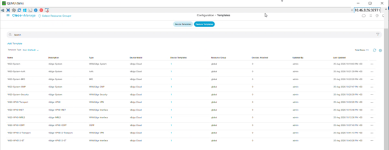
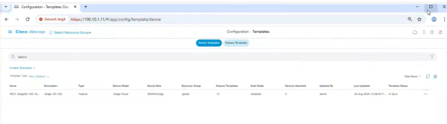
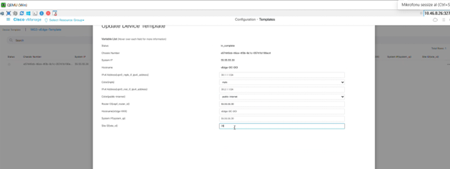
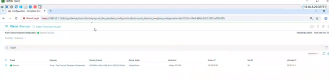
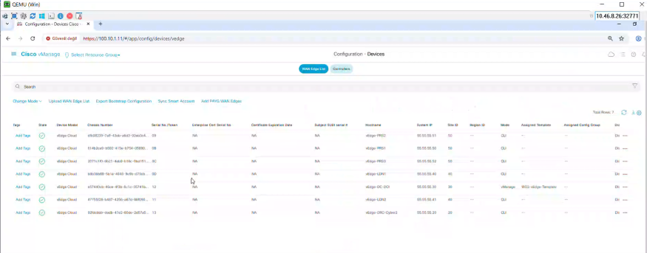

# Phase 6 — vManage Template Management

Phase 6 moves **vEdge-DC-DCI** from direct CLI configuration to centralized management through vManage templates.

Target device:

- Hostname: `vEdge-DC-DCI`
- System IP: `55.55.55.30`
- Site ID: `30`
- Organization: `appbee-sdwan-project`
- vBond: `100.10.1.12`

## Phase objective

The workflow is:

1. create Feature Templates,
2. assemble them into a Device Template,
3. attach the Device Template to vEdge-DC-DCI,
4. push the configuration,
5. verify that the device becomes vManage-managed,
6. confirm that network behavior remains healthy after the push.

## Verified post-push state

The preserved CLI evidence confirms:

- System state: **GREEN**
- vManaged: **true**
- Configuration template: **WG3-vEdge-Template**
- Commit pending: **false**
- System identity preserved
- VPN 0 transport configuration preserved
- OSPF point-to-point configuration preserved
- vSmart control connections over MPLS and public Internet: **UP**
- vManage control connection: **UP**
- OMP peers: **UP**
- BFD sessions across the verified fabric: **UP**
- MPLS-facing OSPF neighbor: **FULL**

## Images

### Feature Templates

The Feature Template list shows the system templates together with VPN 0, Internet, MPLS, OSPF and VPN 512 templates used by the Device Template.

### Device Template

The Device Template is present and its template status is **In Sync**.

### Device Specific values

The attachment workflow preserves the target device values, including system IP, hostname, site ID, transport interface IPs/colors and OSPF router ID.

### Push success

The vManage task shows the template configuration push completed with **Success** for vEdge-DC-DCI.

### Device assignment

The WAN Edge device list shows vEdge-DC-DCI in **vManage** mode with **WG3-vEdge-Template** assigned, while the other lab edges remain CLI-managed.

## Evidence

- [verification/cli-evidence/vedge-dc-dci-post-push.txt](verification/cli-evidence/vedge-dc-dci-post-push.txt)
- [verification/phase6-checklist.md](verification/phase6-checklist.md)
- [verification/images/](verification/images/)

## Phase boundary

Phase 6 focuses on centralized template management. Service VPN work belongs to Phase 7 and later.

Any later Service VPN state visible in current CLI output is not used as a Phase 6 acceptance criterion.

**Phase 6 status: ✅ Complete**
