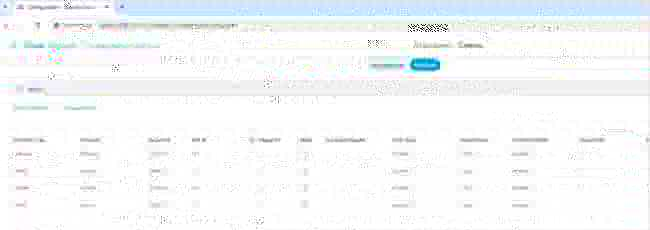

# Phase 4 — vEdge Certificate Installation and Onboarding

Phase 4 brings an SD-WAN edge device into the existing controller fabric.

This phase documents the onboarding workflow using **vEdge-PRS2** as the verified edge example:

- System IP: `55.55.55.51`
- Site ID: `50`
- Organization: `appbee-sdwan-project`
- vBond: `100.10.1.12`
- MPLS transport: `50.1.2.1/24`
- Public Internet transport: `50.2.2.1/24`

## Phase objective

The workflow is:

1. configure the vEdge system and transport baseline,
2. install the enterprise Root CA,
3. generate a CSR,
4. install the signed device certificate,
5. register chassis/serial identity with the controllers,
6. verify control-plane and OMP onboarding.

## Verified live state

The preserved CLI evidence shows:

- Root CA chain: **Installed**
- Device certificate: **Installed / Valid**
- Chassis ID: `dfb08239-7aff-43eb-a6d3-92eb3c4cdfd9`
- Certificate serial: `09`
- vSmart1 and vSmart2 control sessions: **up**
- vManage control session: **up**
- vBond control session over public Internet: **up**
- vSmart1 sees vEdge-PRS2 over both MPLS and public Internet
- OMP peer for vEdge-PRS2: **up**

See:

- [verification/observed-vedge-state.md](verification/observed-vedge-state.md)
- [verification/phase4-checklist.md](verification/phase4-checklist.md)
- [verification/raw/](verification/raw/)

## GUI evidence

The preserved Phase 4 screenshots complement the raw CLI evidence:

### vManage chassis/serial registration

### vBond chassis/serial registration

### WAN Edge certificate inventory

### Controller inventory

These screenshots are preserved historical evidence from the Phase 4 onboarding workflow.

## Phase boundary

The current device state has progressed beyond Phase 4. In particular, the live VPN 0 configuration includes OSPF state introduced during **Phase 5**.

That later configuration is preserved in raw evidence where it appeared, but it is **not** treated as a Phase 4 acceptance criterion.

The Phase 4 configuration file therefore represents the onboarding baseline only:

- [configs/vedge-prs2-phase4-baseline.cfg](configs/vedge-prs2-phase4-baseline.cfg)

## Security note

Password hashes, private keys, CSR bodies and other sensitive authentication material are intentionally excluded from the public repository.
