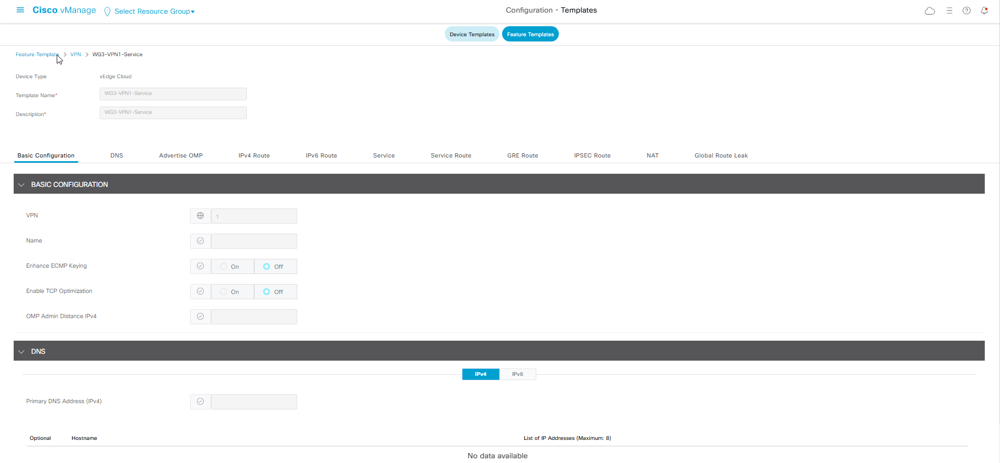
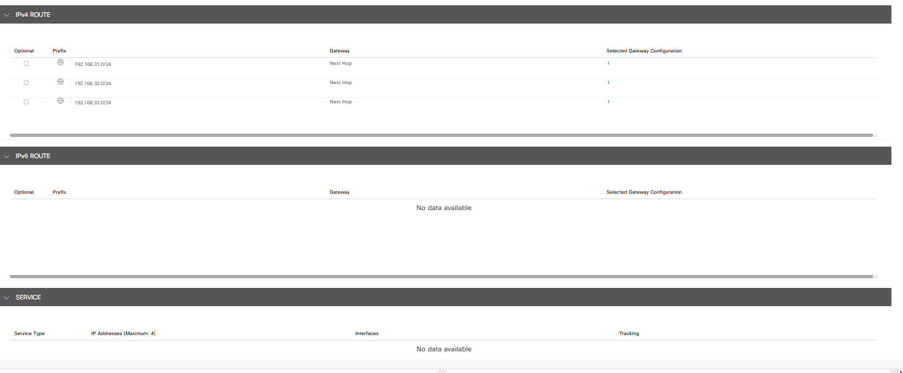
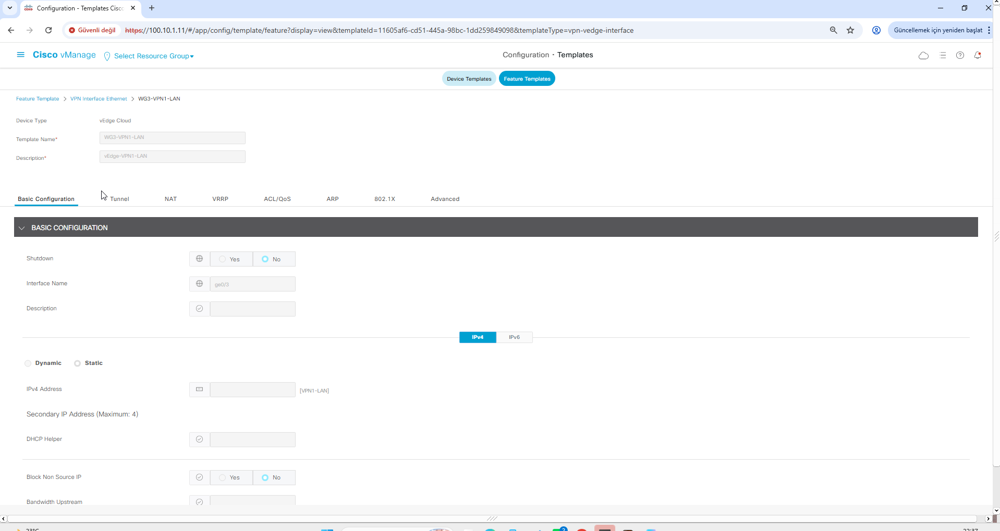
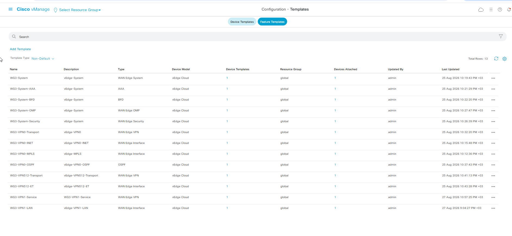
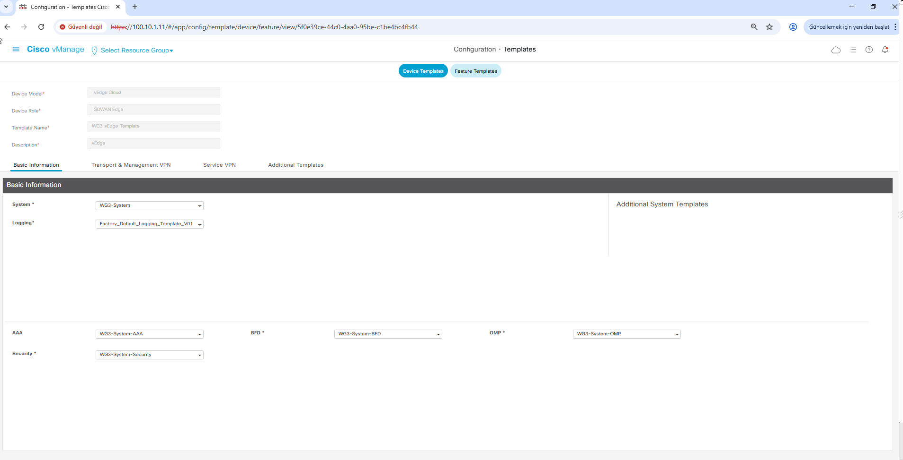
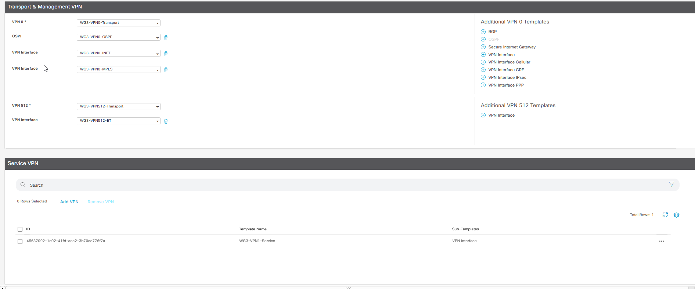
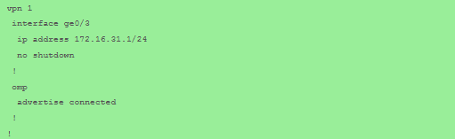
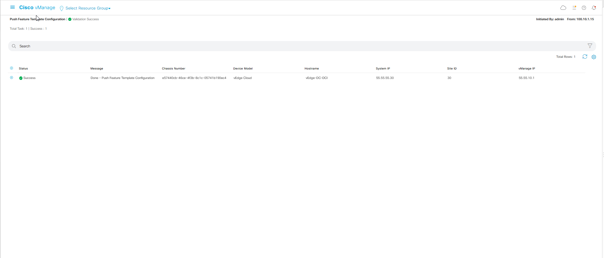
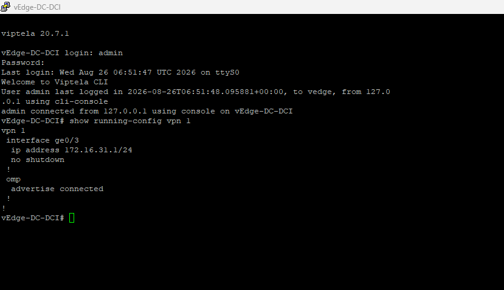
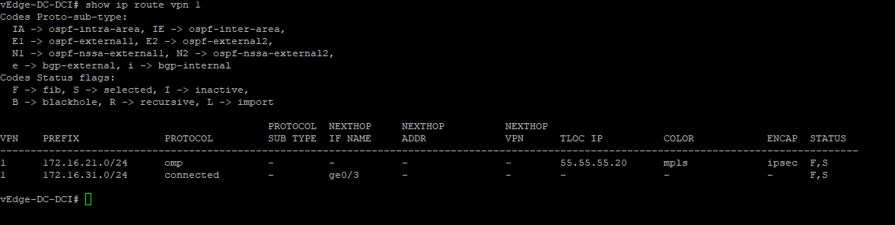

# Phase 7 — Service VPN: Connected & Static Routes

Phase 7 introduces the first user/service traffic layer in the lab through **VPN 1**.

Two configuration methods are used in parallel:

- **vEdge-DRC-Cyber2 (55.55.55.20)** — CLI-managed
- **vEdge-DC-DCI (55.55.55.30)** — vManage template-managed

The objective is to prove that both methods produce the same operational result.

## Verified VPN 1 addressing

### Cyber2

- LAN interface: `ge0/3`
- LAN IP: `172.16.21.1/24`
- next hop: `172.16.21.2`
- local static networks:
  - `192.168.21.0/24`
  - `192.168.22.0/24`
  - `192.168.23.0/24`

### DCI

- LAN interface: `ge0/3`
- LAN IP: `172.16.31.1/24`
- next hop: `172.16.31.2`
- local static networks:
  - `192.168.31.0/24`
  - `192.168.32.0/24`
  - `192.168.33.0/24`

## Verified result

- both VPN 1 interfaces are present and operational
- local connected routes are installed
- local static routes are installed
- remote VPN 1 routes are learned through OMP
- both vSmart OMP peers are UP
- Cyber2 reaches DCI VPN 1 interface
- DCI reaches Cyber2 VPN 1 interface
- traceroute reaches the remote VPN 1 interface directly through the overlay

### End-to-end tests

Cyber2 → DCI:

`ping vpn 1 172.16.31.1` — **7/7 received, 0% loss**

DCI → Cyber2:

`ping vpn 1 172.16.21.1` — **8/9 received, 11% loss**

Both traceroutes reached the remote VPN 1 interface in one hop.

## GUI Evidence

### VPN 1 Service Feature Template

The `WG3-VPN1-Service` Feature Template defines Service VPN **1** for the DCI template-managed path.

### VPN 1 static routes

The IPv4 Route section preserves the three DCI-side static networks:

- `192.168.31.0/24`
- `192.168.32.0/24`
- `192.168.33.0/24`

### VPN 1 LAN interface Feature Template

The `WG3-VPN1-LAN` Feature Template defines the DCI service-side interface `ge0/3`.

### Feature Template inventory

The Feature Template inventory shows the reusable system/transport templates together with the Phase 7 `WG3-VPN1-Service` and `WG3-VPN1-LAN` templates.

### Device Template base

The `WG3-vEdge-Template` Device Template assembles the system-level Feature Templates used by `vEdge-DC-DCI`.

### Device Template Service VPN attachment

The Device Template view shows `WG3-VPN1-Service` attached under **Service VPN**, alongside the existing VPN 0 and VPN 512 components.

### Config Diff

The configuration preview shows the VPN 1 additions before push, including `ge0/3`, `172.16.31.1/24`, and `advertise connected`.

### Push Success

The vManage task reports **Validation Success / Success** for `vEdge-DC-DCI` (System IP `55.55.55.30`, Site ID `30`).

### Post-push running configuration

The live CLI confirms that VPN 1 and `ge0/3` are present after the template push.

### Post-push route table

The live VPN 1 route table confirms the local DCI connected network and remote Cyber2 route learned through OMP.

## Evidence

- [verification/device-verification/vedge-drc-cyber2-vpn1.txt](verification/device-verification/vedge-drc-cyber2-vpn1.txt)
- [verification/device-verification/vedge-dc-dci-vpn1.txt](verification/device-verification/vedge-dc-dci-vpn1.txt)
- [verification/phase7-checklist.md](verification/phase7-checklist.md)
- [verification/images/](verification/images/)
- [docs/cli-vs-template-comparison.md](docs/cli-vs-template-comparison.md)

## Phase status

**✅ Phase 7 complete — VPN 1 connected/static routing, OMP propagation, vManage template push and post-push validation verified.**
