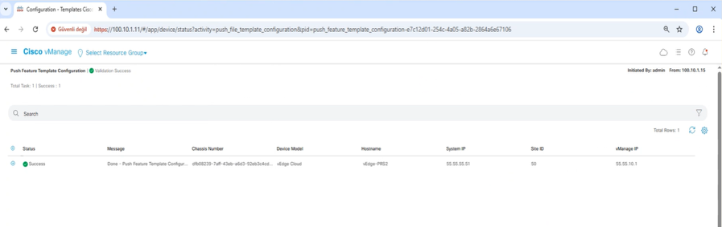
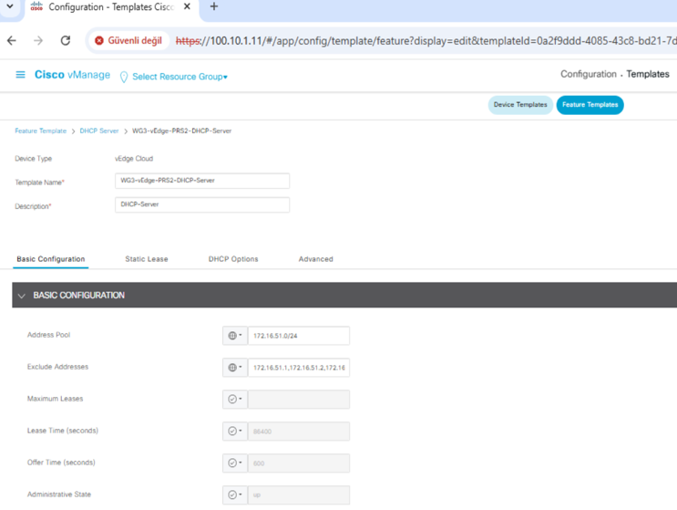
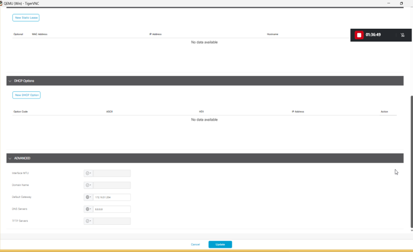
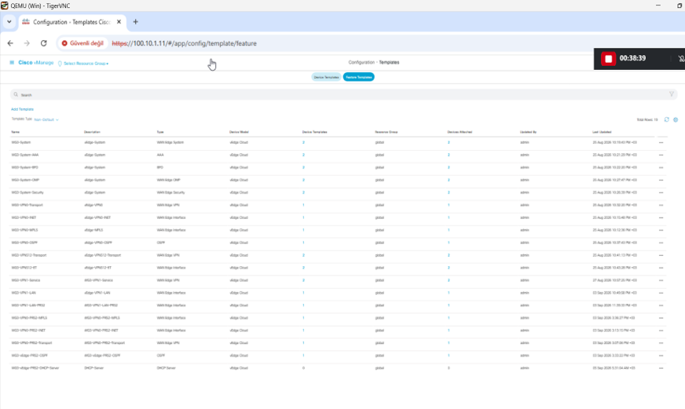
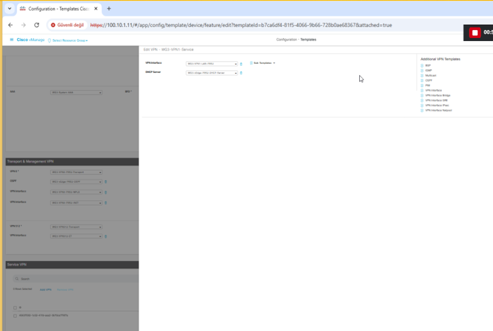
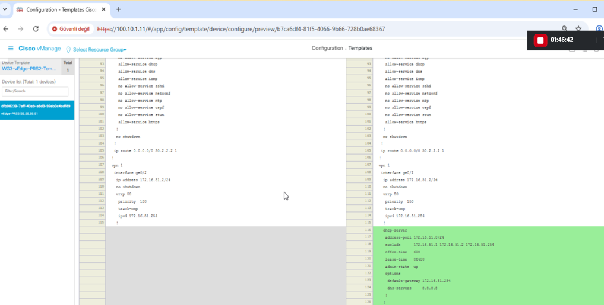
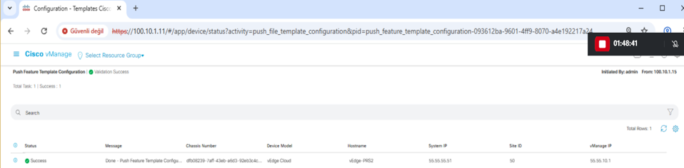

# Phase 8 — Service VPN: VRRP & DHCP

Phase 8 adds branch gateway redundancy and DHCP services to the Paris branch (Site ID 50).

Two configuration methods are used:

- **vEdge-PRS1 (55.55.55.50)** — CLI-managed
- **vEdge-PRS2 (55.55.55.51)** — vManage template-managed

## Working values

- VPN: `1`
- LAN segment: `172.16.51.0/24`
- LAN interface: `ge0/2`
- VRRP group: `50`
- Virtual IP: `172.16.51.254`
- PRS1 IP: `172.16.51.1/24`
- PRS1 priority: `200`
- PRS2 IP: `172.16.51.2/24`
- PRS2 priority: `150`

## DHCP

Both devices use:

- address pool: `172.16.51.0/24`
- excluded addresses:
  - `172.16.51.1`
  - `172.16.51.2`
  - `172.16.51.254`
  - `172.16.51.3`
- offer time: `600`
- lease time: `86400`
- default gateway: `172.16.51.254`
- DNS: `8.8.8.8`

## Verified state

### Normal state

- PRS1: **primary**, priority **200**
- PRS2: **backup**, priority **150**
- both devices use VRRP group **50**
- virtual IP: **172.16.51.254**
- OMP state: **up**

### DHCP

- DHCP server is configured on both devices
- PRS2 has an observed lease for `172.16.51.69`
- DHCP default gateway is the VRRP virtual IP `172.16.51.254`

### Failover

During the failover test, PRS1's LAN side was taken out of service and PRS2 transitioned from **backup** to **primary**.

After PRS1 was restored:

- PRS1 returned to **primary**
- PRS2 returned to **backup**
- OMP state remained **up**

This verifies VRRP takeover and restoration behavior.

A packet-loss count from the continuous-ping portion of the failover test was not preserved, so no numeric packet-loss claim is made.

## GUI Evidence

### PRS2 VRRP template push

The vManage task reports a successful Feature Template push to `vEdge-PRS2`.

### PRS2 DHCP Feature Template — basic configuration

This view documents the DHCP address pool, excluded addresses, lease time, offer time and administrative state.

### PRS2 DHCP gateway and DNS options

The DHCP settings use the VRRP virtual IP `172.16.51.254` as the default gateway and `8.8.8.8` as DNS.

### Feature Template inventory

The vManage Feature Templates view preserves the PRS2-related template inventory used for the Paris branch.

### Device Template / Service VPN composition

This view shows the Service VPN composition inside the PRS2 Device Template and the association of the Paris VPN 1 components.

### DHCP Config Diff

The configuration preview shows the DHCP server block being added while the existing VRRP configuration remains present.

### DHCP template push success

The final vManage task reports validation/push success for `vEdge-PRS2`.

## Scope note

Current device output also contains routing configuration introduced by later work, including VPN 1 OSPF. Those later-phase elements are preserved in device state but are excluded from Phase 8 acceptance criteria.

## Evidence

- [configs/](configs/)
- [verification/device-verification/vedge-prs1-vrrp-dhcp.txt](verification/device-verification/vedge-prs1-vrrp-dhcp.txt)
- [verification/device-verification/vedge-prs2-vrrp-dhcp.txt](verification/device-verification/vedge-prs2-vrrp-dhcp.txt)
- [verification/phase8-checklist.md](verification/phase8-checklist.md)
- [verification/images/](verification/images/)

## Phase status

**✅ Phase 8 complete — VRRP, DHCP, failover takeover and role restoration verified.**
